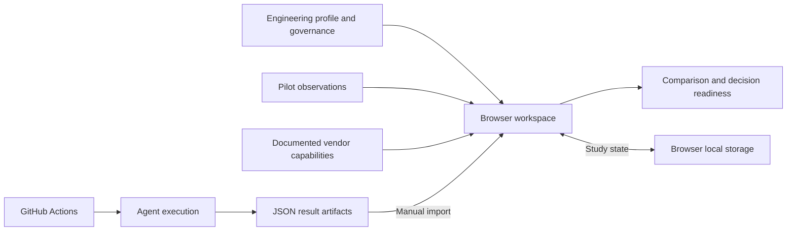

<div align="center">


# Basis

**Choose AI coding tools with evidence that fits your team.**

A workspace for comparing coding agents through your engineering needs, governance requirements, pilot results, and reproducible benchmark runs. Define what matters, collect evidence, and understand what is still missing before making a decision.

[](https://pouyanjay.github.io/basis/)
[](https://github.com/PouyanJay/basis/actions/workflows/pages.yml)
[](LICENSE)
[](package.json)
[](.github/workflows/pages.yml)

[Capabilities](#what-you-can-do) · [Quick start](#quick-start) · [Evidence model](#evidence-model) · [Agent execution](#agent-execution) · [Development](#development) · [Documentation](#documentation)

[**Open the live app →**](https://pouyanjay.github.io/basis/) · No account or API key required to explore the workspace.


<sub>A new study starts with no pilot results or preloaded vendor scores.</sub>

</div>

## Why Basis exists

Choosing a coding agent involves more than a benchmark score. A tool needs to fit your codebase, satisfy your organization's controls, and deliver useful work after review, rework, and operating costs are included.

Basis brings those questions into one study. It connects an engineering profile, governance gates, task-level observations, and documented vendor capabilities, while keeping the provenance and limits of each result visible.

**Current status:** the static application is deployed and browser-tested. Agent execution and SWE-bench Lite workflows are implemented, but credentialed vendor runs and official Docker grading have not yet been validated end to end. Imported results remain unverified evidence.

## What you can do

| Workspace | Purpose |
|---|---|
| **Engineering DNA** | Describe your team and workload so comparisons reflect your engineering context. |
| **Governance** | Track required controls for each candidate and identify failed or unverified gates. |
| **Pilot studio** | Define tasks and acceptance criteria, then collect pilot observations. |
| **Compare** | Explore scenario costs, including human effort, and compare available evidence. |
| **Technology intelligence** | Inspect documented vendor capabilities with links to their sources. |
| **Judge integrity** | Review evaluation safeguards and the independence of acceptance evidence. |
| **Decision room** | See decision readiness and the evidence gaps that prevent a defensible recommendation. |
| **Agent execution** | Configure supported agent runs through GitHub Actions and import their result summaries. |
| **Benchmark library** | Discover external suites, configure SWE-bench Lite samples, and import normalized reports. |

The interface pairs neutral charcoal surfaces and compact Inter typography with restrained violet accents. The precision star mark anchors the sidebar and browser icon; study readiness indicators show actual governance, task, and run counts. Layouts adapt to desktop and mobile screens. Study state is stored in your browser's local storage; it is specific to that browser and origin, with no shared database or account synchronization.

## Quick start

Use the [hosted app](https://pouyanjay.github.io/basis/), or serve it locally with Python 3:

```sh
git clone https://github.com/PouyanJay/basis.git
cd basis
python3 -m http.server 8000
```

Open **http://localhost:8000**. The frontend uses native JavaScript modules and has no build step or npm dependencies. With Node.js installed, `npm start` launches the same server.

### Your first study

1. Describe your team and workload in **Engineering DNA**.
2. Review each candidate's required controls in **Governance**.
3. Define representative tasks and acceptance criteria in **Pilot studio**.
4. Collect observations or import results from a supported execution workflow.
5. Explore costs and evidence in **Compare**, then review readiness in **Decision room**.

An empty or incomplete study is expected to show that no defensible winner is available.

## Evidence model

Basis keeps documented capabilities, automated checks, and independent acceptance distinct.

| Evidence | What it establishes |
|---|---|
| **Documented vendor capability** | A sourced claim about a tool; it is not an experimentally verified result. |
| **Manual observation or imported report** | User-provided evidence, treated as self-reported and unverified. |
| **Automated test result** | Technical evidence from a specific task and run; it does not establish human acceptance. |
| **Independently reviewed, digest-linked record** | Required for verified eligibility. The prototype does not yet provide a reviewer sign-off UI. |

New studies contain no synthetic vendor scores or pilot results, and mock records are rejected on import. Unverified evidence cannot produce a procurement winner. Benchmark comparisons require matching dataset and harness versions, task sets, and evaluation conditions; a sampled run is not an official leaderboard score.

The help menu is rules-based. Devin and xAI appear in the candidate catalog but do not have working execution adapters.

## Agent execution

The [public-fixture workflow](.github/workflows/agent-benchmark.yml) supports these adapters:

| Agent | Workflow identifier | Repository secret |
|---|---|---|
| Claude Code | `claude` | `ANTHROPIC_API_KEY` |
| Cursor | `cursor` | `CURSOR_API_KEY` |
| Codex | `codex` | `OPENAI_API_KEY` |
| OpenCode | `opencode` | Provider key matching the selected `provider/model` |

To run the included integration task:

1. Configure the appropriate repository **Actions Secret**. The optional local helper, `python3 scripts/credential_companion.py`, requires an authenticated GitHub CLI.
2. Open **Actions → Run coding-agent benchmark (public fixtures only)**.
3. Select the agent and optional model, confirm the public fixture, and start the workflow.
4. Download `agent-result.json` from the workflow artifact and import it in **Agent execution**.

The fixture is a small coding task for integration testing. A successful run alone does not demonstrate that one vendor is better than another. Provider credentials and compatible CLI versions are required; API usage may incur costs.

### SWE-bench Lite

The [SWE-bench Lite workflow](.github/workflows/swebench-lite.yml) prepares a shared deterministic sample, runs selected agents, grades generated patches with the official Docker harness, and normalizes the outcomes for import.

- Choose a percentage of the 300-task Lite test set and a reproducible seed.
- Use the same sample across agents; 10% selects 30 tasks and 25% selects 75.
- Configure Docker and more than 40 GB of free runner disk space.
- Import each successful job's `basis-report.json` in **Benchmark library**.

Follow [SWEBENCH_SETUP.md](SWEBENCH_SETUP.md) for runner configuration, costs, grading semantics, and known limitations. Credentialed runs and official grading still require end-to-end validation. Terminal-Bench and SWE-bench Pro are catalog/import entries; bundled execution workflows are not provided for them.

### Credentials and execution boundaries

Keep provider keys in Actions Secrets or the local credential companion, never in the public Pages application. The deployment publishes only the static application files and brand icon.

Agent workflows execute generated code. The included public fixture is the supported smoke-test scope; proprietary or untrusted repositories require additional runner isolation and secret scoping. For substantial evaluations, use a private evaluation repository and an appropriately isolated runner. The UI opens GitHub Actions for explicit dispatch; it does not run paid jobs directly in the browser.

## How it works

The browser handles study state and comparisons. Python scripts and GitHub Actions handle external execution; results return through explicit JSON imports.



## Development

Use Node.js 22, matching CI, and Python 3. Browser checks additionally require Playwright and Chromium.

```sh
# Core logic, benchmark report validation, and deterministic sampling
npm test
python3 -m unittest discover -s tests -p test_sampling.py -v

# JavaScript syntax checks
node --check app.js
node --check technology.js

# Browser checks
python3 -m venv .venv
source .venv/bin/activate
python -m pip install playwright
python -m playwright install chromium
python tests/ui_test.py
```

On Linux runners, install browser system dependencies with `python -m playwright install --with-deps chromium`.

The main browser check covers navigation, scenario cost editing, task creation, governance persistence, mobile overflow, responsive navigation, and page errors. Screenshots are saved to the ignored `test-results/ui/` directory.

### Project layout

```text
index.html                 Static application entry point
app.js                     Interface, browser state, and interactions
core.js                    Study model, evaluation logic, and validation
technology.js              Vendor capability catalog and source links
benchmarks.js              Benchmark catalog and report validation
styles.css                 Neutral workspace theme and responsive layouts
brand.svg                  Precision star mark and browser icon
scripts/                   Agent execution, grading, sampling, and helpers
fixtures/agent_task/       Public coding task for integration runs
benchmark-tests/           Checks used by the agent evaluation pipeline
tests/                     JavaScript, Python, and browser checks
.github/workflows/         Deployment and evaluation workflows
docs/assets/               README screenshots
```

## Deployment

In your repository, enable **Settings → Pages → Source → GitHub Actions**. Pages must be enabled before the deployment action can create a site.

Every push to `main` runs the [Pages workflow](.github/workflows/pages.yml): JavaScript tests, Python sampling tests, syntax checks, and browser QA. After verification, it stages only `index.html`, `app.js`, `core.js`, `technology.js`, `benchmarks.js`, `styles.css`, and `brand.svg`, then deploys that artifact to GitHub Pages.

## Documentation

| Guide | Contents |
|---|---|
| [SWE-bench Lite setup](SWEBENCH_SETUP.md) | Provider keys, runner requirements, sampling, grading, and run limitations. |
| [Benchmark library](BENCHMARKS.md) | Report schema and upstream suite references. Its original execution roadmap predates the SWE-bench Lite workflow; use the setup guide for that workflow. |
| [Execution status](EXECUTION_STATUS.md) | Execution boundaries and outstanding provider validation. |
| [Implementation plan](IMPLEMENTATION_PLAN.md) | Project implementation notes and planned work. |

## Contributing

Issues and pull requests are welcome. Include reproduction steps for bugs, source links for capability changes, and the relevant checks for code changes. Keep benchmark provenance explicit and preserve the distinction between automated results and independently accepted evidence.

## License

[Apache License 2.0](LICENSE). External benchmark datasets, harnesses, and provider tools retain their own licenses and terms.
