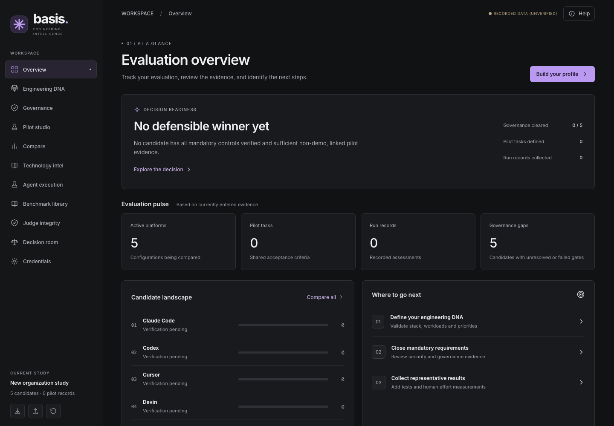
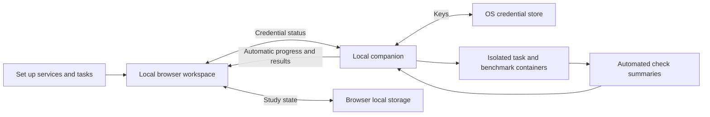

<div align="center">


# Basis

**Choose AI coding tools with evidence that fits your team.**

A workspace for comparing coding agents through your engineering needs, governance requirements, pilot results, and reproducible benchmark runs. Define what matters, collect evidence, and understand what is still missing before making a decision.

[](https://pouyanjay.github.io/basis/)
[](https://github.com/PouyanJay/basis/actions/workflows/pages.yml)
[](LICENSE)
[](package.json)
[](.github/workflows/pages.yml)

[Capabilities](#what-you-can-do) · [Quick start](#quick-start) · [Evidence model](#evidence-model) · [Agent execution](#agent-execution) · [Development](#development) · [Documentation](#documentation)

[**Open the live app →**](https://pouyanjay.github.io/basis/) · No account or API key required to explore the workspace.



<sub>A new study starts with no pilot results or preloaded vendor scores.</sub>

</div>

## Why Basis exists

Choosing a coding agent involves more than a benchmark score. A tool needs to fit your codebase, satisfy your organization's controls, and deliver useful work after review, rework, and operating costs are included.

Basis brings those questions into one study. It connects an engineering profile, governance gates, task-level observations, and documented vendor capabilities, while keeping the provenance and limits of each result visible.

**Current status:** the static application is deployed and browser-tested. Local evaluation execution, saved plans, run history, cancellation, review, and optional benchmark integration are implemented. Automated tests cover the browser/backend workflow and container boundaries. Paid vendor calls have not been validated end to end; imported reports remain unverified evidence.

## What you can do

| Area | Purpose |
|---|---|
| **Home** | A guided path through setup, execution, and results. |
| **Set up** | Team context, service selection, requirements, and task definitions with acceptance criteria. |
| **Run evaluation** | Execute setup tasks and SWE-bench Lite; monitor preparation and runs, then compare models. |
| **Results** | Compare saved run outcomes, inspect requirement assessments, record human review, and include/exclude benchmark evidence. |
| **Tool catalog** | Documented vendor capabilities and their primary sources. |
| **Settings** | Shared OS credential status and local evaluation data. |

The interface pairs neutral charcoal surfaces and compact Inter typography with restrained violet accents. The precision star mark anchors the sidebar and browser icon; the home screen introduces the evaluation workflow before showing detailed analysis. Layouts adapt to desktop and mobile screens. Study state is stored in your browser's local storage; it is specific to that browser and origin, with no shared database or account synchronization. A hard refresh preserves this data. Use **Settings → Reset evaluation** to clear the local study, imported results, and run settings; export the study and keep original report files first if you need them. Reset does not delete OS credentials or saved local evaluations.

## Quick start

Use the [hosted app](https://pouyanjay.github.io/basis/) to explore the workspace. To save credentials and execute your evaluation, run Basis locally with Python 3.9+ and Docker:

```sh
git clone https://github.com/PouyanJay/basis.git
cd basis
python3 -m venv .venv
.venv/bin/python -m pip install -r requirements-local.txt
.venv/bin/python scripts/credential_companion.py
```

Open **http://127.0.0.1:8765/**. On Windows, use `.venv\Scripts\python.exe` instead. Start Docker before running a test. The frontend uses native JavaScript modules and has no build step.

### Your first evaluation

1. **Set up:** describe team context, define tasks with acceptance criteria, then select services, models, and evaluation criteria. A task can start empty or from a local source folder. Optionally supply an independent checks folder and command.
2. **Services & criteria:** set the model and key in each selected service row. Keys saved in Settings already show **Configured**.
3. **Run evaluation:** use the **Benchmarks** tab to add SWE-bench Lite. Its card checks prerequisites, downloads pinned tasks, caches Docker images, and reports preparation progress. Other benchmarks are visible but inactive. Existing Lite reports can be imported and reviewed within its card. Choose **Continue to run** to review readiness, set a time limit, authorize provider usage, and start. Switching tabs preserves your selection.
4. Watch progress or stop the run. The first run builds the agent image and may take several minutes.
5. **Results:** select a saved evaluation, inspect each attempt and its local files, record human acceptance/effort/cost, and compare services. Benchmark evidence can be included or excluded without deleting it.

The runner freezes your setup and input files before starting. Every service gets the same initial source in its own workspace. Editing setup afterward does not change an existing evaluation. Run history survives browser reloads and companion restarts; unfinished runs become interrupted.

No GitHub execution workflow, repository secret, or artifact transfer is required. The hosted site is a setup/exploration interface; automatic execution requires opening the local companion. Use **Continue locally** at the end of Services & criteria to transfer your setup to the running local companion. Hosted-page keys are held only in memory, sent directly to the local window, and saved in the OS credential store. Reloading the hosted page clears prepared keys. The local app asks before replacing an existing populated setup.

Team context and acceptance criteria guide agent prompts. Requirements, workload mix, and decision priorities are preserved for review. Governance requirements are not automatically certified by coding tests. Provider costs and human effort remain unknown until explicitly recorded; Basis does not enforce a monetary budget.

## Evidence model

Basis keeps documented capabilities, automated checks, and independent acceptance distinct.

| Evidence | What it establishes |
|---|---|
| **Documented vendor capability** | A sourced claim about a tool; it is not an experimentally verified result. |
| **Manual observation or imported report** | User-provided evidence, treated as self-reported and unverified. |
| **Automated test result** | Technical evidence from a specific task and run; it does not establish human acceptance. |
| **Independently reviewed, digest-linked record** | Required for verified eligibility. The review UI records self-reported acceptance, not independent identity verification. |

New studies contain no synthetic vendor scores or pilot results, and mock records are rejected on import. Unverified evidence cannot produce a procurement winner. Benchmark comparisons require matching dataset and harness versions, task sets, and evaluation conditions; a sampled run is not an official leaderboard score.

The help menu is rules-based. Devin and xAI appear in the candidate catalog but do not have working execution adapters.

## Agent execution

The local runner supports these adapters:

| Agent | Identifier | OS credential entry |
|---|---|---|
| Claude Code | `claude` | `ANTHROPIC_API_KEY` |
| Cursor | `cursor` | `CURSOR_API_KEY` |
| Codex | `codex` | `OPENAI_API_KEY` |
| OpenCode | `opencode` | `OPENAI_API_KEY` for `openai/model`, or `ANTHROPIC_API_KEY` for `anthropic/model` |

Each supported service attempts every selected task sequentially. Unsupported services block automatic execution with an actionable readiness message; they are never silently omitted. Set an explicit model in **Set up → Services & criteria** for reproducibility. An empty model uses the CLI default, which is labeled as unpinned; OpenCode requires `openai/model` or `anthropic/model`.

### Credentials and execution boundaries

Keys are stored in macOS Keychain, Windows Credential Locker, Linux Secret Service, or KWallet. The interface receives presence flags, not values. **Configured** means saved, not provider-validated. Keys are passed only to the selected agent container, never to builds or the verifier. Agent stdout/stderr is not persisted because it can expose credentials.

The companion copies source into disposable per-attempt workspaces; original folders are never mounted. Copies exclude `.git`, `.env`/`.env.*`, `.ssh`, `.aws`, private-key files, dependency directories, and virtual environments. This is not a comprehensive secret scanner: choose source appropriate for the provider. Copies are limited to 100 MB / 10,000 files per folder; symlink files and special files are rejected, and symlink directories are skipped.

Containers use an unprivileged user, read-only root, dropped capabilities, temporary home, and CPU/memory/process/time limits. Only the disposable work folder is mounted writable. Agents have provider network access. Independent checks are mounted read-only **only in a second container**, without provider keys or network access. The Docker socket is never mounted. The runtime includes Python 3, Node.js, and Git; additional project dependencies must be available in the copied work or installed there during the agent attempt. Arbitrary test commands execute inside the container, never on the host.

Plans, input snapshots, generated work, results, and human review are retained at:

```text
~/.local/share/basis/evaluations/<run-id>/
  plan.json                 Frozen setup, tasks, services, source/check digests
  inputs/<task>/            Original source and independent checks
  attempts/<task>/<agent>/  Generated work for review
  result.json               Status, outcomes, and separate human review annotations
```

Resetting browser setup does not remove these files or OS credentials. Export a result with its plan from **Results**. Generated work may contain sensitive content supplied to the agent; it stays local. Never use administrative provider keys for tasks that do not need them.

The companion binds to loopback, validates Host and Origin, requires a session token for API requests, and serves only allowlisted frontend assets. Statuses distinguish completed, partial (attempt errors/timeouts), stopped, interrupted, and failed runs. A failed automated check is an evaluation outcome, not an infrastructure failure. Missing checks are shown as **Not checked**, not as success.

### Integrated benchmarks

**SWE-bench Lite** is the active benchmark. On **Run evaluation → Benchmarks**, choose 1–300 tasks (default 5), then **Add benchmark**. The card reports checking, downloading, preparation, errors with retry, and readiness. Cancel stops preparation; retry reuses downloaded tools and images. Removing a benchmark excludes it from the next run without deleting its cache. Preparation does not call model providers.

Basis pins the dataset to `6ec7bb89b9342f664a54a6e0a6ea6501d3437cc2`, the official `swebench` package to `3.0.15`, and each downloaded image by digest. Tasks are sorted by instance ID and shuffled with seed 0, so every service/model receives the same selected tasks. A dedicated Python environment installs automatically. Docker needs at least 8 GB RAM and 20 GB free host disk for initial preparation; larger selections require more disk, including space in Docker's own disk image. Official x86 images run through Docker's emulation on Apple Silicon.

Agents edit a source snapshot in Basis's standard isolated coding environment (2 CPUs, 2 GB RAM). The independent official SWE-bench harness grades their patches in the pinned task environment (2 CPUs, 4 GB RAM, no network or provider credentials). Agents do not receive gold patches or hidden checks. Repository-specific dependencies are available to the grader; the Basis agent environment is not the official repository environment. These local runs are **not official leaderboard submissions**.

The selected tasks, dataset/harness versions, image digests, source digests, generated patches, grading logs, and reports are retained locally. Results compare models separately for each suite; errors and ungraded attempts remain visible. Paid provider execution starts only after the normal Run consent. No API spending cap is enforced.

HumanEval, local packs, SWE-bench Verified, Pro, and Terminal-Bench are currently inactive in the UI. Their retained utilities and historical results are not deleted. Existing Lite reports use the Basis v1 report format and remain explicitly unverified; importing does not enqueue any tasks. See [SWEBENCH_SETUP.md](SWEBENCH_SETUP.md) for retained command-line tooling.

To verify real official grading without paid model calls, prepare one Lite task, then run:

```sh
.venv/bin/python tests/swebench_integration_test.py
```

This opt-in test uses a known correct patch and an unchanged solution, with reports saved separately from user history. Routine tests use fixtures and do not download benchmark images.

## How it works



## Development

Use Node.js 22, matching CI, and Python 3. Browser checks additionally require Playwright and Chromium.

```sh
# Core logic, benchmark report validation, and deterministic sampling
npm test
python3 -m unittest discover -s tests -p 'test_*.py' -v

# JavaScript syntax checks
node --check app.js
node --check technology.js

# Browser checks
python3 -m venv .venv
source .venv/bin/activate
python -m pip install playwright
python -m playwright install chromium
python tests/ui_test.py
python tests/local_ui_test.py
python tests/benchmark_ui_test.py
# Optional real Docker checks; uses a test-only agent, never a provider API
python tests/container_evaluation_test.py
```

On Linux runners, install browser system dependencies with `python -m playwright install --with-deps chromium`.

The main browser check covers grouped navigation, shared credential detection, local run prerequisites, automatic results, task creation, frozen plan execution, benchmark evidence selection, human review, governance persistence, mobile overflow, responsive navigation, and page errors. Screenshots are saved to the ignored `test-results/ui/` directory.

### Project layout

```text
index.html                 Static application entry point
app.js                     Interface, browser state, and interactions
core.js                    Study model, evaluation logic, and validation
technology.js              Vendor capability catalog and source links
benchmarks.js              Benchmark catalog and report validation
styles.css                 Neutral workspace theme and responsive layouts
brand.svg                  Precision star mark and browser icon
scripts/                   Agent execution, grading, sampling, and helpers
fixtures/agent_task/       Legacy fixture for standalone CLI development
benchmark-tests/           Checks used by the agent evaluation pipeline
tests/                     JavaScript, Python, and browser checks
.github/workflows/         Deployment, tests, and source health checks
docs/assets/               README screenshots
```

## Deployment

In your repository, enable **Settings → Pages → Source → GitHub Actions**. Pages must be enabled before the deployment action can create a site.

Every push to `main` runs the [Pages workflow](.github/workflows/pages.yml): JavaScript tests, Python sampling tests, syntax checks, and browser QA. After verification, it stages only `index.html`, `app.js`, `core.js`, `technology.js`, `benchmarks.js`, `styles.css`, and `brand.svg`, then deploys that artifact to GitHub Pages. The staging script gives assets content-versioned filenames and rewrites module imports so each deployment loads matching JavaScript and styles instead of cached files from a previous release.

## Documentation

| Guide | Contents |
|---|---|
| [SWE-bench Lite setup](SWEBENCH_SETUP.md) | Provider keys, runner requirements, sampling, grading, and run limitations. |
| [Benchmark library](BENCHMARKS.md) | Report schema and upstream suite references. |
| [Execution status](EXECUTION_STATUS.md) | Execution boundaries and outstanding provider validation. |
| [Implementation plan](IMPLEMENTATION_PLAN.md) | Project implementation notes and planned work. |

## Contributing

Issues and pull requests are welcome. Include reproduction steps for bugs, source links for capability changes, and the relevant checks for code changes. Keep benchmark provenance explicit and preserve the distinction between automated results and independently accepted evidence.

## License

[Apache License 2.0](LICENSE). External benchmark datasets, harnesses, and provider tools retain their own licenses and terms.

### Model selection

Under **Set up → Services & criteria**, save a provider key first. The local companion fetches models using that key; the selector stays disabled until discovery succeeds. Keys already saved in Settings are detected automatically. Use Refresh to reload the catalog. Replacing a key discards the previous catalog. Hosted setup transfers to the local app before discovery; no provider keys are sent from the hosted page.

- Claude Code: authenticated [Anthropic Models API](https://platform.claude.com/docs/en/api/models/list), including pagination.
- Codex: authenticated [OpenAI Models API](https://developers.openai.com/api/reference/resources/models/methods/list).
- Cursor: authenticated [Cursor CLI model listing](https://cursor.com/changelog/cli-jan-08-2026), using an installed `cursor-agent` or the existing `basis-local-runner:v2` Docker image. If neither is available, install the Cursor CLI or build the runner with `docker build -t basis-local-runner:v2 -f scripts/local-runner.Dockerfile .`.
- OpenCode: choose OpenAI or Anthropic, save that provider's key, then select a returned model. Basis adds the required provider prefix.

There are no static model lists or fallback aliases. Saved models absent from the returned catalog require reselection. Provider catalogs report API visibility, not a successful coding-agent execution: some listed models may be unsuitable for a particular CLI, and quota or runtime compatibility can still fail during a run. Discovery makes no generation requests. Custom services have no discovery adapter.

### Live run activity

Run evaluation shows preparation, task execution, checks, elapsed time, and completed attempt counts. A compact footer inside the run card holds the time limit, provider consent, and Run button. Execution details are available from its help icon. Active status lights pulse gently and respect reduced-motion preferences.

Expand Runner setup or an individual service to inspect its output, follow new lines, copy, or download the retained log. Claude Code uses its [documented streaming output](https://code.claude.com/docs/en/headless); Basis displays public text and tool names, not thinking blocks or initialization payloads. Quiet periods mean the process has not emitted output, not that progress has been estimated.

Activity retains the latest 300 lines across the run (up to 2,000 characters each); oversized lines are omitted. Active provider keys and common credential patterns are redacted before storage. Redaction cannot identify every possible sensitive value in arbitrary task output; review logs before sharing. Older runs have no captured console output. Restart the local companion after updating to enable activity capture for new runs.

### Compare models within a service

In **Set up → Services & criteria**, save the provider key, then add one or more models from the authenticated catalog. Selected models appear below the selector and can be removed individually (up to ten per service). Each selected service–model combination attempts every team task and selected benchmark task separately, using the same starting files and independent checks.

Each combination has its own workspace, console, attempt results, and human reviews. Results compare models in separate rows, including models from the same service. Requirements remain service-level assessments shared by that service's models. Existing single-model studies and saved results remain readable. More models mean more attempts and potential API charges.

### Usage accounting

New local attempts retain allowlisted CLI token telemetry in `result.usage` and
export it with `usageSummary` (candidate total, each candidate/model, and a separate
`judgeRuns` ledger). Failed attempts count too. Each aggregate includes recorded,
complete, and total attempt counts; a subtotal with missing evidence is **partial**.
Legacy runs are not backfilled. Manual review costs stay separate from telemetry.

- Input means **uncached** input. Cache reads and writes are separate; output includes
  reasoning where the runner reports it. Missing fields are null, never assumed zero.
- Claude's final `modelUsage` accounts for the main agent and subagents. It replaces
  intermediate measurements; repeated message IDs and final events are not added
  twice. Without a final result, observed input/cache counts are partial and per-step
  output placeholders are not reported as output totals.
- Codex JSON turn telemetry reports input inclusive of cache. Cache counts are
  subtracted for uncached input. Dollar cost is unavailable when the CLI does not
  report it; Basis does not guess model pricing.
- OpenCode JSON step telemetry is deduplicated by part ID; visible and reasoning
  output tokens are combined. These are partial observed-step totals because child
  sessions may not be included. Cursor currently has no captured usage telemetry.
- Dollar values are **CLI estimates**, not invoice charges. Zero cost with nonzero
  consumed tokens is treated as unavailable pricing. Values retain their precision
  in storage, with four decimal places (or `< $0.0001`) in the UI.
- Interrupted runs can omit billed usage. Observed measurements are saved during
  execution, but neither partial counts nor client estimates establish the bill.
  Judge accounting is separate; recommendation calls are recorded in their own ledger.

Accounting references: [Claude cost tracking](https://code.claude.com/docs/en/agent-sdk/cost-tracking),
[Codex JSON mode](https://learn.chatgpt.com/docs/non-interactive-mode), and
[OpenCode token normalization](https://github.com/anomalyco/opencode/blob/dev/packages/core/src/session/usage.ts).

### Judge setup and requirement evidence

Settings now configures only the judge (OpenAI or Anthropic). Judge keys use the
separate `basis-judge` OS-credential namespace and are never stored in browser
storage, study exports, or `judge-settings.json`. Test connection lists models
with that credential; Save judge validates the selected ID against that catalog.
This checks catalog access, not generation capability or judging quality. No
model is hardcoded and no paid generation request is made by configuration.

Set up → Services & criteria → Requirements groups runtime, provider/account,
and organizational requirements. A verified or failed human review requires an
HTTPS evidence link, notes, reviewer, and review timestamp. Previous review
versions remain in the study's `gateEvidence` history. Existing unsupported pass
flags remain Needs review. These are recorded human assessments, not automatic
certifications of a provider or account. Saved evaluations keep their setup
snapshot; editing the current setup does not rewrite historical runs.

The authenticated local `evidence-package` endpoint takes an evaluation `id` and
builds a bounded package from that saved run, independent check outcomes, usage,
human reviews, and allowlisted artifacts. It excludes private grader inputs and
keeps candidate identities outside the quality-assessment input. Artifact text
remains explicitly untrusted; identity masking is not guaranteed if code reveals
it. Evidence links are recorded, not fetched. The digest changes with included
evidence, enabling stale-recommendation detection. Building the package alone does not
send anything to a provider; generation is an explicit user action.


### Judge recommendations

Results retains the detailed results as its first tab. Recommendation is the
second tab, with a compact five-or-more-model table, evidence links, expandable
analysis, Copy and Markdown export. Generate explicitly authorizes up to two
paid calls to the separately configured judge: blinded quality assessment, then
synthesis against the saved team context, priorities, costs and requirements.
No paid calls start on page load, review changes, connection testing, or retries
unless the user clicks Generate/Retry. The selected catalog model must support
the structured API used by its provider; unsupported models produce an inline
error rather than silently substituting a different model.

Progress follows real stages: evidence preparation, comparison, recommendation.
Completed quality summaries appear while synthesis runs. These are report
findings, not private reasoning or token-by-token output. Stop prevents further
stages; an already-sent request is allowed to finish so reported usage can be
retained. Its provider may still charge. Restarted requests are marked interrupted
and never automatically replayed. Network calls time out after 180 seconds.

`evaluations/<id>/recommendations.json` preserves generations and per-call usage,
including failed parsing, failed requests, and stopped generations. Frozen
`judge-evidence-<generation>.json` snapshots preserve evidence, candidate mapping,
references, suite exclusions and digest. They are available through Saved files.
Reviews, included-suite changes, and artifact edits mark a report out of date.
Stale reports retain their original measured snapshot and lose their preferred
highlight. Original evaluation evidence is never rewritten by the judge.

Reports are structurally validated and escaped before display. Candidate aliases
and evidence references must exist, every candidate must be assessed exactly
once, and unknown fields are rejected. Objective measurements are rendered from
the saved evidence, never from model prose. Artifacts and reviews are untrusted
input; the judge has no executable tools or browsing. Quality candidate order is
randomized and reversed for synthesis, which reduces some bias but does not
establish independence. One-task runs cannot produce a preferred-model badge.
Mandatory unresolved requirements keep readiness conditional; coding checks do
not certify organizational controls. The judge can still make mistakes: follow
the linked evidence and human-review its assessment.

Judge tokens come from provider usage fields (uncached input, output, cache reads
and writes). Standard global API list-price estimates use exact supported IDs and
a saved price revision/source; unknown models, nonstandard tiers, large contexts,
and uncertain cache-write pricing remain unknown rather than being guessed.
These estimates are not invoices. Current price sources:
[OpenAI pricing](https://developers.openai.com/api/docs/pricing) and
[Anthropic pricing](https://platform.claude.com/docs/en/about-claude/pricing).
API formats follow [OpenAI structured outputs](https://developers.openai.com/api/docs/guides/structured-outputs)
and [Anthropic Messages](https://platform.claude.com/docs/en/build-with-claude/working-with-messages).

Validation uses fake providers through the real HTTP and browser paths:
`python tests/recommendation_ui_test.py` and `python -m unittest discover -s tests -p 'test_recommendations.py'`.
No live paid judge call is required by the test suite.

Recommendation activity shows recorded preparation/call timestamps, with a live
elapsed clock and an indeterminate indicator while a request is in flight. It
does not invent token-level progress. The Evidence panel separates Sources,
Method and Usage; coverage is derived from the frozen judge snapshot (including
older generations), and all-generation judge costs include failed calls. Tabs
and expanded sections remain stable during polling.
