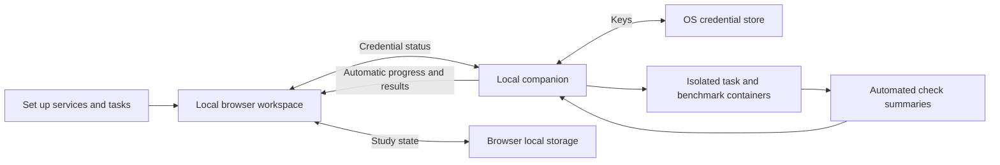

<div align="center">


# Basis

**Choose AI coding tools with evidence that fits your team.**

A workspace for comparing coding agents through your engineering needs, governance requirements, pilot results, and reproducible benchmark runs. Define what matters, collect evidence, and understand what is still missing before making a decision.

[](https://pouyanjay.github.io/basis/)
[](https://github.com/PouyanJay/basis/actions/workflows/pages.yml)
[](LICENSE)
[](package.json)
[](.github/workflows/pages.yml)

[Capabilities](#what-you-can-do) · [Quick start](#quick-start) · [Evidence model](#evidence-model) · [Agent execution](#agent-execution) · [Development](#development) · [Documentation](#documentation)

[**Open the live app →**](https://pouyanjay.github.io/basis/) · No account or API key required to explore the workspace.


<sub>A new study starts with no pilot results or preloaded vendor scores.</sub>

</div>

## Why Basis exists

Choosing a coding agent involves more than a benchmark score. A tool needs to fit your codebase, satisfy your organization's controls, and deliver useful work after review, rework, and operating costs are included.

Basis brings those questions into one study. It connects an engineering profile, governance gates, task-level observations, and documented vendor capabilities, while keeping the provenance and limits of each result visible.

**Current status:** the static application is deployed and browser-tested. Local evaluation execution, saved plans, run history, cancellation, review, and optional benchmark integration are implemented. Automated tests cover the browser/backend workflow and container boundaries. Paid vendor calls have not been validated end to end; imported reports remain unverified evidence.

## What you can do

| Area | Purpose |
|---|---|
| **Home** | A guided path through setup, execution, and results. |
| **Set up** | Team context, service selection, requirements, and task definitions with acceptance criteria. |
| **Run evaluation** | Execute setup tasks and optional HumanEval or local benchmark packs; monitor progress and stop runs. |
| **Results** | Compare saved run outcomes, inspect requirement assessments, record human review, and include/exclude benchmark evidence. |
| **Tool catalog** | Documented vendor capabilities and their primary sources. |
| **Settings** | Shared OS credential status and local evaluation data. |

The interface pairs neutral charcoal surfaces and compact Inter typography with restrained violet accents. The precision star mark anchors the sidebar and browser icon; the home screen introduces the evaluation workflow before showing detailed analysis. Layouts adapt to desktop and mobile screens. Study state is stored in your browser's local storage; it is specific to that browser and origin, with no shared database or account synchronization. A hard refresh preserves this data. Use **Settings → Reset evaluation** to clear the local study, imported results, and run settings; export the study and keep original report files first if you need them. Reset does not delete OS credentials or saved local evaluations.

## Quick start

Use the [hosted app](https://pouyanjay.github.io/basis/) to explore the workspace. To save credentials and execute your evaluation, run Basis locally with Python 3.9+ and Docker:

```sh
git clone https://github.com/PouyanJay/basis.git
cd basis
python3 -m venv .venv
.venv/bin/python -m pip install -r requirements-local.txt
.venv/bin/python scripts/credential_companion.py
```

Open **http://127.0.0.1:8765/**. On Windows, use `.venv\Scripts\python.exe` instead. Start Docker before running a test. The frontend uses native JavaScript modules and has no build step.

### Your first evaluation

1. **Set up:** describe team context, define tasks with acceptance criteria, then select services, models, and evaluation criteria. A task can start empty or from a local source folder. Optionally supply an independent checks folder and command.
2. **Services & criteria:** set the model and key in each selected service row. Keys saved in Settings already show **Configured**.
3. **Run evaluation:** optionally add HumanEval tasks or local benchmark packs, set a time limit, review readiness, authorize provider usage, and press **Run evaluation**.
4. Watch progress or stop the run. The first run builds the agent image and may take several minutes.
5. **Results:** select a saved evaluation, inspect each attempt and its local files, record human acceptance/effort/cost, and compare services. Benchmark evidence can be included or excluded without deleting it.

The runner freezes your setup and input files before starting. Every service gets the same initial source in its own workspace. Editing setup afterward does not change an existing evaluation. Run history survives browser reloads and companion restarts; unfinished runs become interrupted.

No GitHub execution workflow, repository secret, or artifact transfer is required. The hosted site is a setup/exploration interface; automatic execution requires opening the local companion. Use **Continue locally** at the end of Services & criteria to transfer your setup to the running local companion. Hosted-page keys are held only in memory, sent directly to the local window, and saved in the OS credential store. Reloading the hosted page clears prepared keys. The local app asks before replacing an existing populated setup.

Team context and acceptance criteria guide agent prompts. Requirements, workload mix, and decision priorities are preserved for review. Governance requirements are not automatically certified by coding tests. Provider costs and human effort remain unknown until explicitly recorded; Basis does not enforce a monetary budget.

## Evidence model

Basis keeps documented capabilities, automated checks, and independent acceptance distinct.

| Evidence | What it establishes |
|---|---|
| **Documented vendor capability** | A sourced claim about a tool; it is not an experimentally verified result. |
| **Manual observation or imported report** | User-provided evidence, treated as self-reported and unverified. |
| **Automated test result** | Technical evidence from a specific task and run; it does not establish human acceptance. |
| **Independently reviewed, digest-linked record** | Required for verified eligibility. The review UI records self-reported acceptance, not independent identity verification. |

New studies contain no synthetic vendor scores or pilot results, and mock records are rejected on import. Unverified evidence cannot produce a procurement winner. Benchmark comparisons require matching dataset and harness versions, task sets, and evaluation conditions; a sampled run is not an official leaderboard score.

The help menu is rules-based. Devin and xAI appear in the candidate catalog but do not have working execution adapters.

## Agent execution

The local runner supports these adapters:

| Agent | Identifier | OS credential entry |
|---|---|---|
| Claude Code | `claude` | `ANTHROPIC_API_KEY` |
| Cursor | `cursor` | `CURSOR_API_KEY` |
| Codex | `codex` | `OPENAI_API_KEY` |
| OpenCode | `opencode` | `OPENAI_API_KEY` for `openai/model`, or `ANTHROPIC_API_KEY` for `anthropic/model` |

Each supported service attempts every selected task sequentially. Unsupported services block automatic execution with an actionable readiness message; they are never silently omitted. Set an explicit model in **Set up → Services & criteria** for reproducibility. An empty model uses the CLI default, which is labeled as unpinned; OpenCode requires `openai/model` or `anthropic/model`.

### Credentials and execution boundaries

Keys are stored in macOS Keychain, Windows Credential Locker, Linux Secret Service, or KWallet. The interface receives presence flags, not values. **Configured** means saved, not provider-validated. Keys are passed only to the selected agent container, never to builds or the verifier. Agent stdout/stderr is not persisted because it can expose credentials.

The companion copies source into disposable per-attempt workspaces; original folders are never mounted. Copies exclude `.git`, `.env`/`.env.*`, `.ssh`, `.aws`, private-key files, dependency directories, and virtual environments. This is not a comprehensive secret scanner: choose source appropriate for the provider. Copies are limited to 100 MB / 10,000 files per folder; symlink files and special files are rejected, and symlink directories are skipped.

Containers use an unprivileged user, read-only root, dropped capabilities, temporary home, and CPU/memory/process/time limits. Only the disposable work folder is mounted writable. Agents have provider network access. Independent checks are mounted read-only **only in a second container**, without provider keys or network access. The Docker socket is never mounted. The runtime includes Python 3, Node.js, and Git; additional project dependencies must be available in the copied work or installed there during the agent attempt. Arbitrary test commands execute inside the container, never on the host.

Plans, input snapshots, generated work, results, and human review are retained at:

```text
~/.local/share/basis/evaluations/<run-id>/
  plan.json                 Frozen setup, tasks, services, source/check digests
  inputs/<task>/            Original source and independent checks
  attempts/<task>/<agent>/  Generated work for review
  result.json               Status, outcomes, and separate human review annotations
```

Resetting browser setup does not remove these files or OS credentials. Export a result with its plan from **Results**. Generated work may contain sensitive content supplied to the agent; it stays local. Never use administrative provider keys for tasks that do not need them.

The companion binds to loopback, validates Host and Origin, requires a session token for API requests, and serves only allowlisted frontend assets. Statuses distinguish completed, partial (attempt errors/timeouts), stopped, interrupted, and failed runs. A failed automated check is an evaluation outcome, not an infrastructure failure. Missing checks are shown as **Not checked**, not as success.

### External benchmarks

**HumanEval** is available directly on Run evaluation. Basis downloads a SHA-256-verified dataset pinned to upstream revision `b9453e8f1865df0a0057a1383767caa400acfbcf`, selects a deterministic subset (seed 0, 1–50 tasks), and executes original held-out checks against each generated `solution.py`. The [upstream project](https://github.com/openai/human-eval) is historical and unmaintained. This adapter uses agent workflows rather than the original completion sampling harness: results are **not official leaderboard scores**.

You can also add a local benchmark pack by absolute path. Paths within the pack are relative to the manifest. Each benchmark task must have independent checks:

```json
{
  "schemaVersion": 1,
  "name": "Team Python benchmark",
  "revision": "2026-10-22",
  "source": "https://example.com/benchmark-source",
  "tasks": [{
    "name": "Implement input validation",
    "acceptance": "Reject invalid input and preserve valid input.",
    "sourcePath": "cases/validation/source",
    "checksPath": "cases/validation/checks",
    "checkCommand": "python3 /checks/test_validation.py"
  }]
}
```

Checks run with `/work` as their working directory; `/checks` contains the immutable checks. Python checks can load `/work/solution.py` using `runpy.run_path`. No paid call is needed to validate the pack format. Up to five packs and 100 combined tasks are allowed. Manifest revisions, SHA-256 digests, exact tasks, and input digests are saved with the run.

**Results → Imported benchmark reports** retains support for authentic external reports. SWE-bench and Terminal-Bench still require their own official harnesses; Basis does not mislabel local packs as those official evaluations. See [SWEBENCH_SETUP.md](SWEBENCH_SETUP.md) for retained command-line tooling.

## How it works



## Development

Use Node.js 22, matching CI, and Python 3. Browser checks additionally require Playwright and Chromium.

```sh
# Core logic, benchmark report validation, and deterministic sampling
npm test
python3 -m unittest discover -s tests -p 'test_*.py' -v

# JavaScript syntax checks
node --check app.js
node --check technology.js

# Browser checks
python3 -m venv .venv
source .venv/bin/activate
python -m pip install playwright
python -m playwright install chromium
python tests/ui_test.py
python tests/local_ui_test.py
python tests/benchmark_ui_test.py
# Optional real Docker checks; uses a test-only agent, never a provider API
python tests/container_evaluation_test.py
```

On Linux runners, install browser system dependencies with `python -m playwright install --with-deps chromium`.

The main browser check covers grouped navigation, shared credential detection, local run prerequisites, automatic results, task creation, frozen plan execution, benchmark evidence selection, human review, governance persistence, mobile overflow, responsive navigation, and page errors. Screenshots are saved to the ignored `test-results/ui/` directory.

### Project layout

```text
index.html                 Static application entry point
app.js                     Interface, browser state, and interactions
core.js                    Study model, evaluation logic, and validation
technology.js              Vendor capability catalog and source links
benchmarks.js              Benchmark catalog and report validation
styles.css                 Neutral workspace theme and responsive layouts
brand.svg                  Precision star mark and browser icon
scripts/                   Agent execution, grading, sampling, and helpers
fixtures/agent_task/       Legacy fixture for standalone CLI development
benchmark-tests/           Checks used by the agent evaluation pipeline
tests/                     JavaScript, Python, and browser checks
.github/workflows/         Deployment, tests, and source health checks
docs/assets/               README screenshots
```

## Deployment

In your repository, enable **Settings → Pages → Source → GitHub Actions**. Pages must be enabled before the deployment action can create a site.

Every push to `main` runs the [Pages workflow](.github/workflows/pages.yml): JavaScript tests, Python sampling tests, syntax checks, and browser QA. After verification, it stages only `index.html`, `app.js`, `core.js`, `technology.js`, `benchmarks.js`, `styles.css`, and `brand.svg`, then deploys that artifact to GitHub Pages. The staging script gives assets content-versioned filenames and rewrites module imports so each deployment loads matching JavaScript and styles instead of cached files from a previous release.

## Documentation

| Guide | Contents |
|---|---|
| [SWE-bench Lite setup](SWEBENCH_SETUP.md) | Provider keys, runner requirements, sampling, grading, and run limitations. |
| [Benchmark library](BENCHMARKS.md) | Report schema and upstream suite references. |
| [Execution status](EXECUTION_STATUS.md) | Execution boundaries and outstanding provider validation. |
| [Implementation plan](IMPLEMENTATION_PLAN.md) | Project implementation notes and planned work. |

## Contributing

Issues and pull requests are welcome. Include reproduction steps for bugs, source links for capability changes, and the relevant checks for code changes. Keep benchmark provenance explicit and preserve the distinction between automated results and independently accepted evidence.

## License

[Apache License 2.0](LICENSE). External benchmark datasets, harnesses, and provider tools retain their own licenses and terms.

### Model selection

Under **Set up → Services & criteria**, save a provider key first. The local companion fetches models using that key; the selector stays disabled until discovery succeeds. Keys already saved in Settings are detected automatically. Use Refresh to reload the catalog. Replacing a key discards the previous catalog. Hosted setup transfers to the local app before discovery; no provider keys are sent from the hosted page.

- Claude Code: authenticated [Anthropic Models API](https://platform.claude.com/docs/en/api/models/list), including pagination.
- Codex: authenticated [OpenAI Models API](https://developers.openai.com/api/reference/resources/models/methods/list).
- Cursor: authenticated [Cursor CLI model listing](https://cursor.com/changelog/cli-jan-08-2026), using an installed `cursor-agent` or the existing `basis-local-runner:v2` Docker image. If neither is available, install the Cursor CLI or build the runner with `docker build -t basis-local-runner:v2 -f scripts/local-runner.Dockerfile .`.
- OpenCode: choose OpenAI or Anthropic, save that provider's key, then select a returned model. Basis adds the required provider prefix.

There are no static model lists or fallback aliases. Saved models absent from the returned catalog require reselection. Provider catalogs report API visibility, not a successful coding-agent execution: some listed models may be unsuitable for a particular CLI, and quota or runtime compatibility can still fail during a run. Discovery makes no generation requests. Custom services have no discovery adapter.
